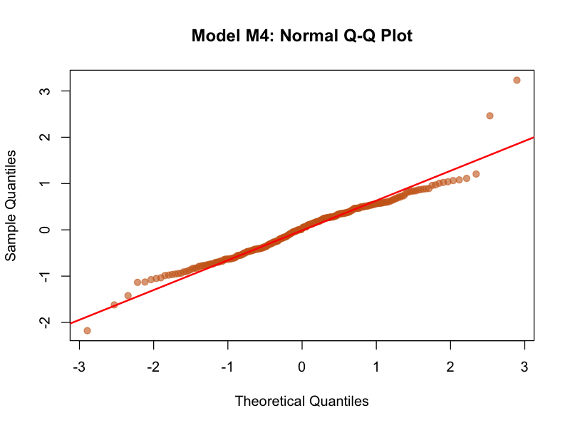
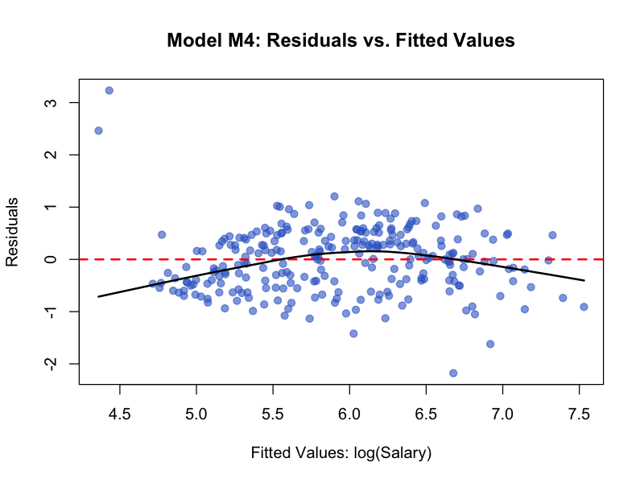

# Econometric Analysis of Major League Baseball Salaries (1986–1987)

**Authors:** Anh Minh Ho, Bruno Meler, Mohamed Aziz Mrad  
**Institution:** Sorbonne Université — Atelier de Recherche Encadrée (Grade: 95/100)  
**Full Report:** [Download Report PDF](./report.pdf)

---

## 1. Research Overview
This empirical study evaluates the determinants of compensation in Major League Baseball (MLB). We examine whether professional player salaries reflect single-season productivity, cumulative historical output, or league experience.

The modeling framework is based on the benchmark statistical challenge presented by **Hoaglin & Velleman (1995)** (*"A Critical Look at Some Analyses of Major League Baseball Salaries"*).

---

## 2. Dataset & Exploratory Data Analysis
The dataset contains 1986 performance metrics and 1987 compensation figures across 322 major league hitters. After excluding 59 records with missing compensation data, the final sample consists of **$n = 263$** hitters.

* **Raw Salary Distribution:** Highly right-skewed with an extended upper tail ($\text{Mean} = \$542.2\text{k}$, $\text{Median} = \$430.0\text{k}$).
* **Tukey Outlier Criterion:** Applying the $Q_3 + 1.5 \times \text{IQR}$ threshold ($\$1,585.5\text{k}$) identifies **11 extreme outliers** ($\approx 3.4\%$ of the sample).
* **Logarithmic Transformation:** Applying $\log(\text{Salary})$ stabilizes residual variance (homoscedasticity), compresses extreme upper-tail leverage, and reformulates the additive model into a multiplicative elasticity model.

---

## 3. Econometric Modeling

To avoid biasing cumulative statistics toward older players, we construct an average annual performance metric:
$$\text{Hits\_per\_year} = \frac{\text{Career Hits}}{\text{Longevity (Years)}}$$

### Summary of Specifications

| Model | Specification | $R^2$ | Adjusted $R^2$ | Residual Std. Error |
| :--- | :--- | :---: | :---: | :---: |
| **M1** | $\log(\text{Salary}) = 5.173 + 0.1047 \cdot \text{Longevity}$ | 0.322 | 0.319 | 0.720 |
| **M2** | $\log(\text{Salary}) = 4.821 + 0.0103 \cdot \text{Hits\_86}$ | 0.263 | 0.260 | 0.751 |
| **M3** | $\log(\text{Salary}) = 4.572 + 0.0151 \cdot \text{Hits\_per\_year}$ | 0.430 | 0.428 | 0.660 |
| **M4** | $\log(\text{Salary}) = 3.993 + 0.0875 \cdot \text{Longevity} + 0.0065 \cdot \text{Hits\_per\_year} + 0.0066 \cdot \text{Hits\_86}$ | **0.621** | **0.617** | **0.540** |

*All predictors in Model M4 are statistically significant at $p < 0.001$.*

### Coefficient Interpretation (Model M4)
* **$\text{Longevity}$ ($\beta = 0.0875$):** Each additional year of service corresponds to an expected $+9.1\%$ increase in annual compensation ($e^{0.0875} - 1$), holding other variables constant.
* **$\text{Hits\_per\_year}$ ($\beta = 0.0065$):** An increase of one base hit per season throughout a career corresponds to a $+0.65\%$ salary increase.
* **$\text{Hits\_86}$ ($\beta = 0.0066$):** Each additional base hit in the immediate preceding season yields an expected $+0.66\%$ increase in salary.

---

## 4. Diagnostics & Limitations

### Residual Normality
The Shapiro-Wilk test yields $W = 0.9878$ ($p = 0.0248$). Although the null hypothesis is rejected at $\alpha = 0.05$ due to sample sensitivity at $n = 263$, the test statistic is close to 1, indicating minor practical deviations.



### Non-Linearity in Longevity
Residual analysis reveals curvature in univariate experience models, demonstrating that player earning power flattens and declines in later veteran years rather than following a purely linear path.



### Unexplained Variance ($37.9\%$)
Omitted structural variables—including defensive fielding position, franchise payroll constraints, and free-agency arbitration eligibility—account for the remaining dispersion.

---

## 5. Reproduction

To reproduce all model calculations and output plots, run:

```bash
Rscript analysis.R