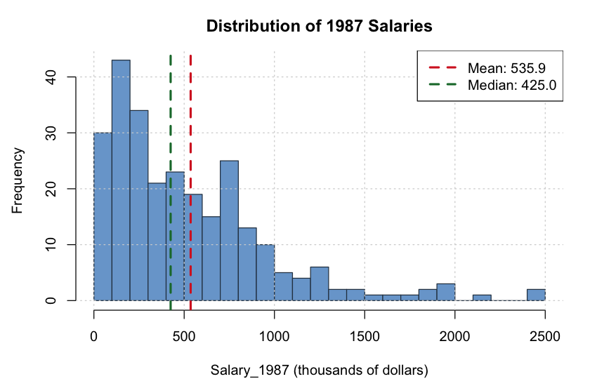
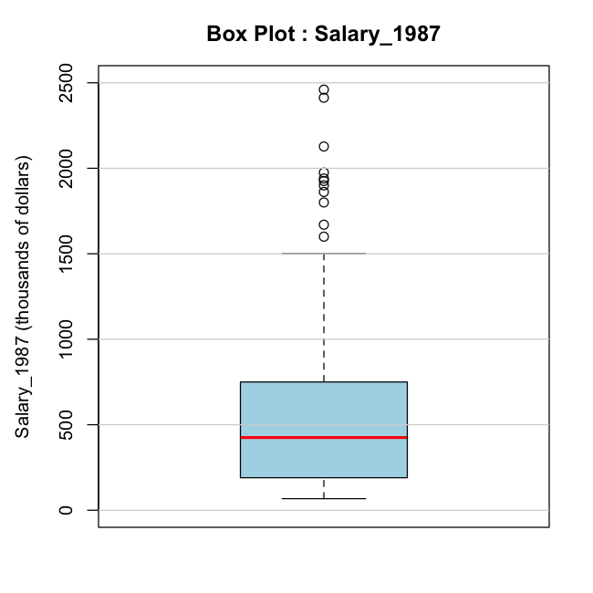
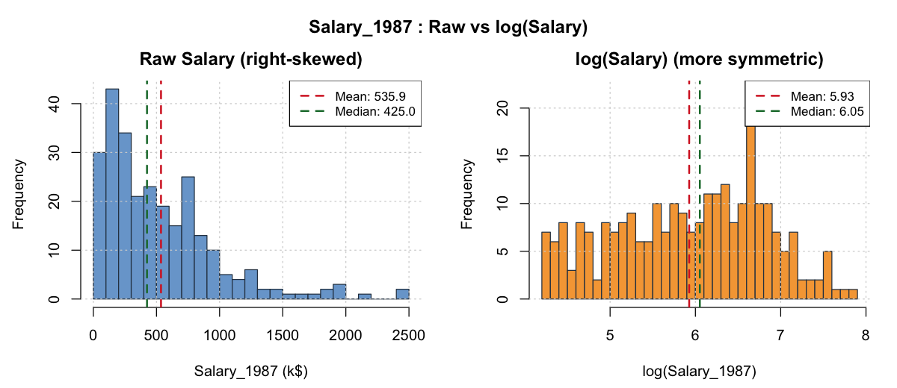
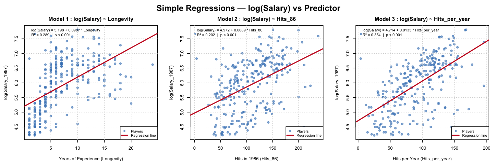
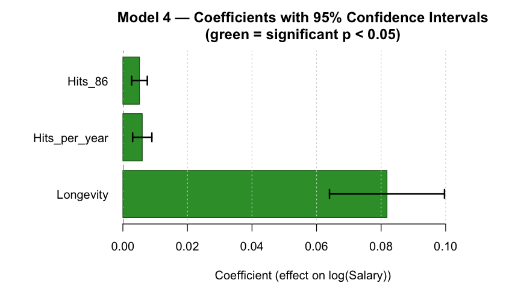
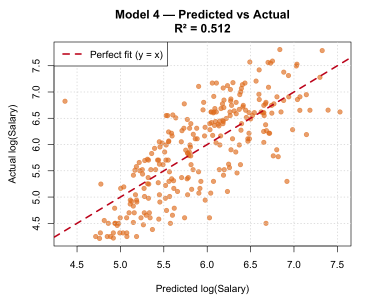
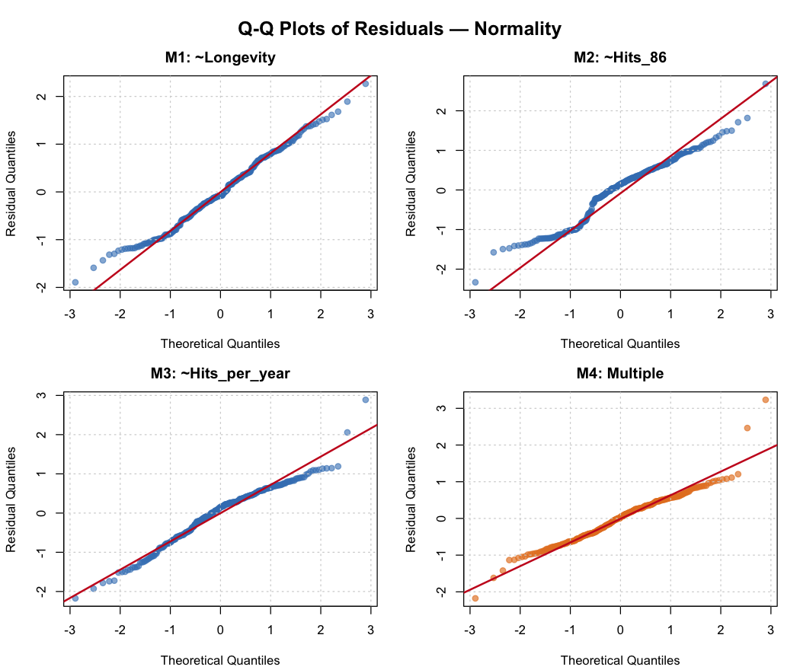
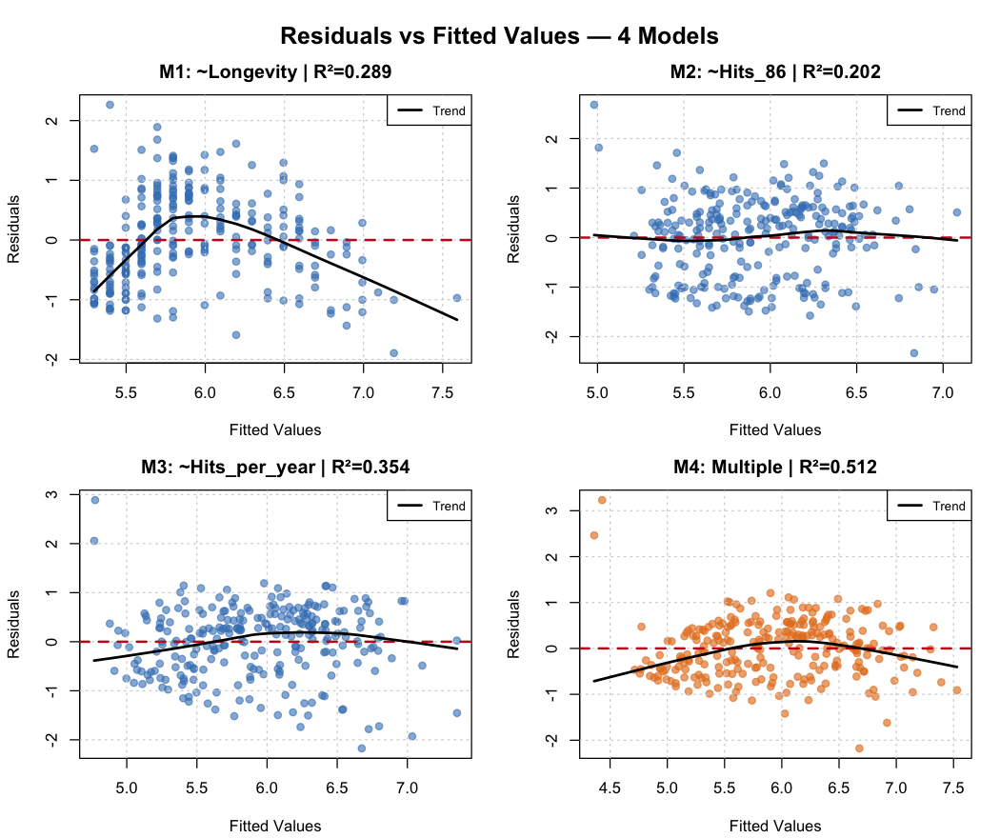

# Econometric Analysis of Major League Baseball Salaries (1986–1987)

**Authors:** Anh Minh Ho, Bruno Meler, Mohamed Aziz Mrad  
**Institution:** Sorbonne Université — Atelier de Recherche Encadrée (Grade: 95/100)  
**Full Report:** [Download Report PDF in french](./report.pdf)
                [Download Report PDF in English](./English_Version_of_Report.pdf)

---

## 1. Research Overview
This empirical study evaluates the determinants of compensation in Major League Baseball (MLB). We examine whether professional player salaries reflect single-season productivity, cumulative historical output, or league experience.

The modeling framework is based on the benchmark statistical challenge presented by **Hoaglin & Velleman (1995)** (*"A Critical Look at Some Analyses of Major League Baseball Salaries"*).

---

## 2. Dataset & Exploratory Data Analysis
The dataset contains 1986 performance metrics and 1987 compensation figures across 322 major league hitters. After excluding 59 records with missing compensation data, the final sample consists of **263 hitters**.

* **Raw Salary Distribution:** Highly right-skewed with an extended upper tail (Mean = 542.2k USD, Median = 430.0k USD).



* **Tukey Outlier Criterion:** Segmenting by quartiles ($Q_1 = 193.0\text{k USD}$, $Q_3 = 750.0\text{k USD}$) and applying the $Q_3 + 1.5 \times \text{IQR}$ threshold (1,585.5k USD) identifies **11 extreme outliers** (~3.4% of the initial dataset, or 4.2% of the 263 complete cases).



* **Logarithmic Transformation:** Applying `log(Salary)` symmetrizes the distribution, stabilizes residual variance (homoscedasticity), compresses extreme upper-tail leverage, and reformulates the additive specification into a multiplicative elasticity model.



---

## 3. Econometric Modeling

To avoid biasing cumulative statistics toward older players, we construct an average annual performance metric:

$$\text{Hits per year} = \frac{\text{Career Hits}}{\text{Longevity}}$$

### Simple Regressions (M1, M2, M3)
Evaluating each predictor individually confirms statistically significant positive associations across all three dimensions:



### Summary of Specifications

| Model | Specification | R² | Adjusted R² | Residual Std. Error |
| :--- | :--- | :---: | :---: | :---: |
| **M1** | log(Salary) = 5.173 + 0.1047 · Longevity | 0.322 | 0.319 | 0.720 |
| **M2** | log(Salary) = 4.821 + 0.0103 · Hits_86 | 0.263 | 0.260 | 0.751 |
| **M3** | log(Salary) = 4.572 + 0.0151 · Hits_per_year | 0.430 | 0.428 | 0.660 |
| **M4** | log(Salary) = 3.993 + 0.0875 · Longevity + 0.0065 · Hits_per_year + 0.0066 · Hits_86 | **0.621** | **0.617** | **0.540** |

*All predictors in Model M4 are statistically significant at p &lt; 0.001.*

### Coefficient Interpretation & Goodness of Fit (Model M4)
* **Longevity** ($\beta = 0.0875$): Each additional year of service corresponds to an expected +9.1% increase in annual compensation ($e^{0.0875} - 1$), holding other variables constant.
* **Hits_per_year** ($\beta = 0.0065$): An increase of one base hit per season throughout a career corresponds to a +0.65% salary increase.
* **Hits_86** ($\beta = 0.0066$): Each additional base hit in the immediate preceding season yields an expected +0.66% increase in salary.



Model M4 explains **62.1%** of the variance in `log(Salary)`, with predicted values clustering tightly around the $y = x$ reference line:



---

## 4. Diagnostics & Limitations

### Residual Normality
The Shapiro-Wilk test on Model M4 yields $W = 0.9878$ ($p = 0.0248$). Although the null hypothesis of exact normality is rejected at $\alpha = 0.05$ due to sample sensitivity at $n = 263$, $W$ is remarkably close to 1, confirming that tail deviations are minor in practice.



### Homoscedasticity & Non-Linearity in Longevity
Residual vs. fitted value diagnostics reveal a pronounced arch shape in M1 (`~Longevity`), demonstrating that player earning power flattens and declines in veteran years rather than increasing linearly forever. Combining all three predictors in M4 substantially flattens the residual trend line around zero.



### Unexplained Variance (37.9%)
Omitted structural variables—including defensive fielding position, franchise payroll constraints, and free-agency arbitration eligibility—account for the remaining dispersion.

---

## 5. Reproduction

To reproduce all model calculations and generate all 8 figures in `./figures/`, run:

```bash
Rscript analysis.R
